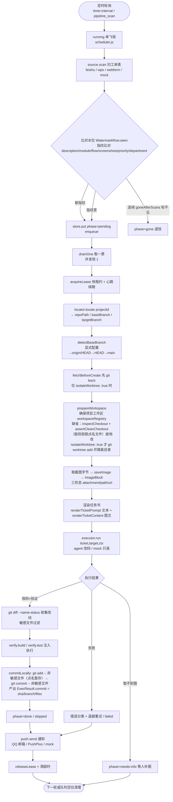
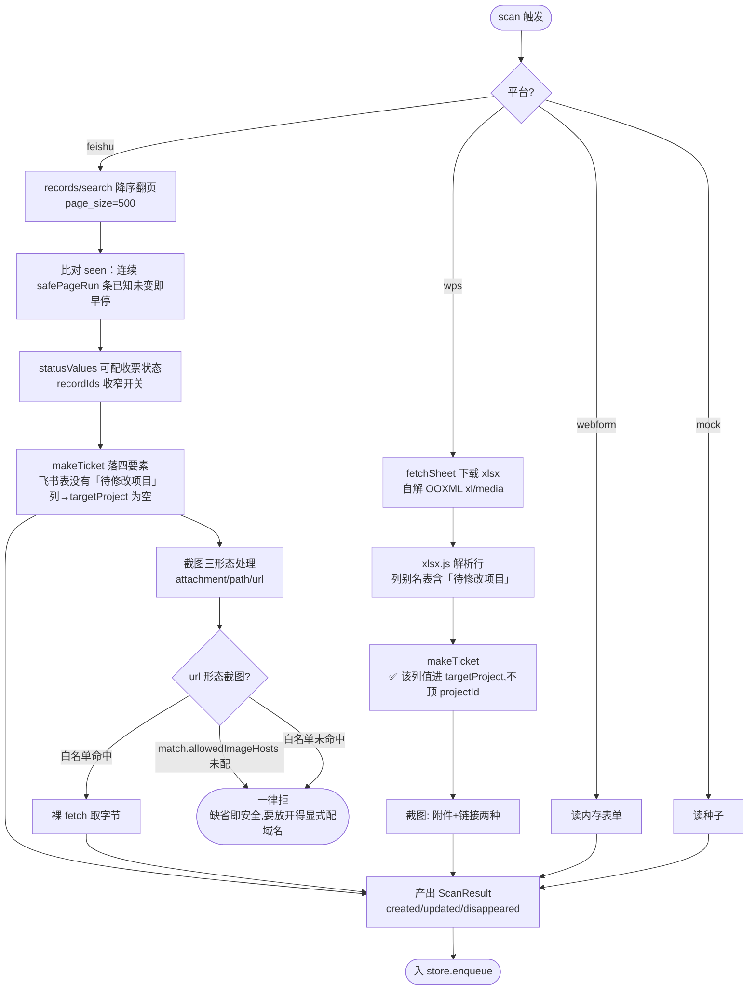
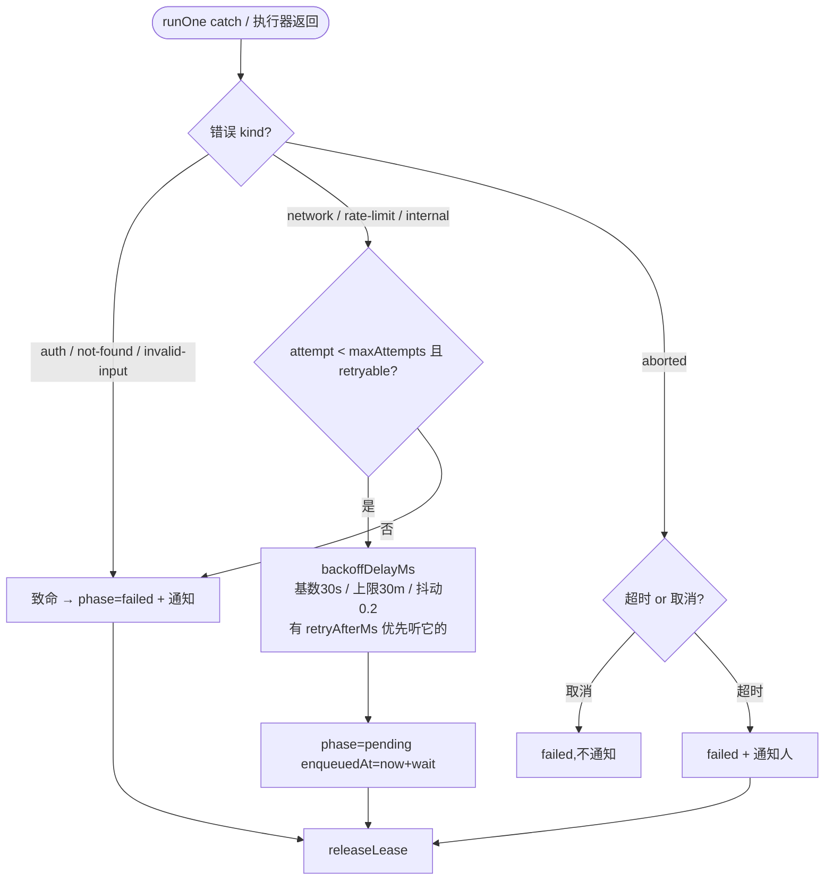
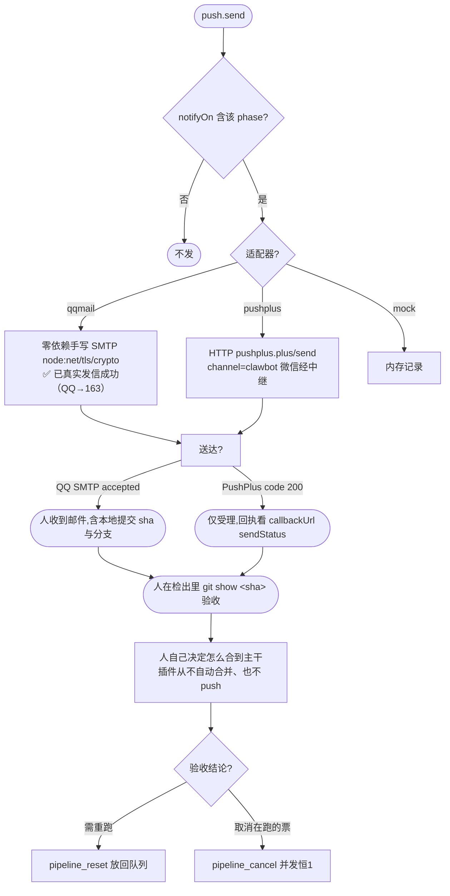
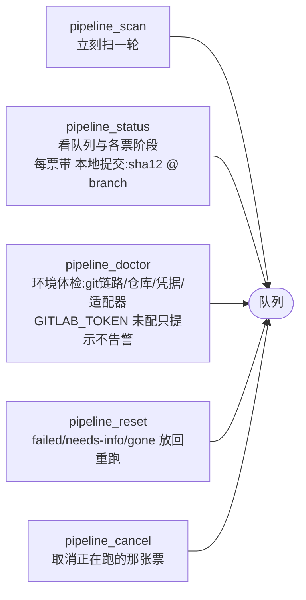

# 工单流水线插件 · 详细操作流程图

> 配套文档：`docs/ticket-pipeline/architecture.md`（四层契约 / 时序）、`docs/ticket-pipeline/feature-checklist.md`（完成度与缺陷）。
> 本图所有节点都对应 `plugins/ticket-pipeline/src` 里真实存在的代码路径（行号取自 2026-11-06 源码）。
> 节点标注：**⚠ = 当前仍卡住的缺口**，**✅ = 本轮已修**。汇总见文末第 7 节。

---

## 1. 总览时序（一次完整跑）



---

## 2. 工单扫描与入队（来源适配层）



> ⚠ 上面 `feishu` 那条支路**只画到多维表格**（`records/search`）。飞书**电子表格**目前进不来 —— 是代码路径问题不是权限问题（`source-feishu/index.js:763-766` 把 `obj_type:'bitable'` 硬写进 query，`:770-775` 把 `sheet` 判成「不是多维表格」；`config.js:494-501` 只认两种绑定形态）。该分支的**设计已定、尚未实施**，探测与扫描两张流程图见 `docs/ticket-pipeline/feishu-sheet-source.md` §3.5 / §5.7。

---

## 3. 执行器：agent 改码 → 验证 → 本地提交

```mermaid
flowchart TD
    E0([executor.run]) --> E1[agentOptionsFromConfig<br/>✅ 空 model 不下传,跟随会话默认]
    E1 --> E2[agents.create sessionId<br/>meta.cwd = workspacePath 项目工作区根<br/>✅ 宿主 attachSession 要求 cwd == 工作区路径]
    E2 --> E3[setupAgent 四件事]
    E3 --> E3a[1. 挂 preset: agentPresets.mount<br/>✅ 挂不上硬失败 invalid-input]
    E3 --> E3b[2. appendDelegatedPolicyOverrides 写策略]
    E3 --> E3c[3. 钉目录: workingDirectory.set → worktreePath<br/>✅ 仅 worktreePath ≠ workspacePath（isolateWorktree 打开）时才需要<br/>缺省模式两者相等,不需要这个服务]
    E3 --> E3d[4. attachSession 归属项目工作区<br/>失败只记日志,不影响改码]
    E3a --> E4[agent.followup 推任务书<br/>⚠ inject 不唤醒,必须 followup]
    E4 --> E5[waitForAgentIdle<br/>seq 连续静 2 次才认结束]
    E5 --> E6[collectChanges: git diff --name-status -z ∪ git status --porcelain -z -uall<br/>✅ 未跟踪新文件也算；排除 .agents/worktrees]
    E6 --> E7{SENSITIVE_FILE_PATTERNS 命中?}
    E7 -->|是| E7a[✅ 拦下且写进提交说明的「未提交」一行,人 git show 就能看到]
    E7 -->|否| E8
    E7a --> E8[runVerification<br/>verify.build / verify.test 注入]
    E8 --> E9{有验证命令?}
    E9 -->|无| E9a[outcome=skipped<br/>phase 仍按契约给 done,但 plan.summary 前置写「⚠ 未通过验证」]
    E9 -->|有| E10[splitCommand 认单双引号<br/>✅ 但刻意不解释 && / 管道 / 重定向]
    E10 --> E11{退出码 0?}
    E11 -->|是| E12[outcome=passed]
    E11 -->|否| E13[outcome=failed]
    E12 --> E14[commitLocally<br/>git restore --staged 退回 agent 自己暂存的敏感文件<br/>git add -- 非删除的文件（点名暂存,不用 add -A）<br/>→ git commit -m 说明 -- 改动文件 ∪ 重命名旧路径]
    E13 --> E14
    E9a --> E14
    E14 --> E14a[git rev-parse HEAD<br/>取回 sha,并带出 branch / files]
    E14a --> E15{repo.gitlab.enabled === true?}
    E15 -->|否（缺省）| E22[commit 就是交付物<br/>不发任何 GitLab 请求、不要 GITLAB_TOKEN]
    E15 -->|是（显式打开远程出口）| E16[openDraftMr → resolveGitlab project,target<br/>✅ repo.gitlab{baseUrl,remote,projectId,enabled} 已能透传]
    E16 --> E17[ensureBranch GET /repository/branches/:branch]
    E17 --> E18[commitFiles POST /repository/commits<br/>actions[] 按文件内容物化]
    E18 --> E19{已有开放 draft MR?}
    E19 -->|是| E20[复用,不撞 409]
    E19 -->|否| E21[POST /merge_requests title:Draft:]
    E21 --> E21a[断言返回 draft===true]
    E20 --> E22
    E21a --> E22
    E22 --> E23[makeExecResult<br/>phase=done/skipped, testOutcome<br/>✅ 必须给 commit 或 mr 之一]
```

---

## 4. 错误分类与重试 / 退避



> 限流识别（`executor-agent/agent-failure.js`）：从 `agent.session.log` 末条 `turn/end` 的 `data.reason.error` 取 code/message，命中 `RATE_LIMIT/QUOTA/SOFT_RATE` 或文案「被限流/rate limit/quota exceeded/429」→ 归一为 `PipelineError(rate-limit)`（可重试）。

---

## 5. 通知与人工闭环



---

## 6. 运维工具（对宿主暴露）



---

## 7. 当前卡点速查

状态基线：HEAD `2488036`（2026-11-06）+ 「本地提交」与「改代码落点」两项改造（工作树未提交），自测 285/285 + 链路冒烟 11/11。

| # | 卡点 | 类型 | 现状 |
| --- | --- | --- | --- |
| P0-3 | 金山无开放平台取数通道 | 取数缺口 | **待接**。只有 `match.sheetUrl` + 全局 fetch（大概率要登录态）或宿主注入 `fetchSheet` |
| P0-6 | 真实飞书表截图是 url 形态，白名单缺省为空 | 配置缺口 | **已能配**（`match.allowedImageHosts`），但要对这张表放开仍需显式填域名 |
| P1-12 | 金山 recordId 用行号 `'r'+rowIndex` | 健壮性 | **已知代价**，未改（插行会让票换身份，代码注释已声明） |
| P1-13 | `pushplus.token` 明文配置 | 安全 | **待改**（QQ 邮箱那条走 `QQMAIL_AUTH_CODE` 凭据，不落配置） |
| P1-7 | 执行器返回 `phase:'failed'` 结果不进退避重试 | 契约耦合 | **已绕开**：限流改成抛 `PipelineError('rate-limit')`（见架构 §8.4） |
| P1-8 | 没配验证命令时 `testOutcome='skipped'` 而 `phase` 仍是 `done` | 正确性 | **已缓解**：契约不变，但 `plan.summary` 最前面写「⚠ 未通过验证（skipped）」 |
| P1-14 | ~~GitLab Commits API 是改动唯一出口~~ | 契约耦合 | **已改**：交付形态改为工作区检出里的本地提交（`commitLocally`）；远程 Commits API 降级成 `repo.gitlab.enabled: true` 才走的可选出口 |
| P2 | 上游模型配额（workbuddy 429 `quota_exceeded`） | 外部因素 | 与插件无关；执行器现在会如实报 `rate-limit` |
| P1-16 | 飞书源只支持**多维表格**，电子表格进不来 | 取数缺口 | **设计已定，待实施**。当前是代码路径问题不是权限问题：`normalizeAppToken` 把 `obj_type:'bitable'` 硬写进 query（`source-feishu/index.js:763-766`），`:770-775` 把 `sheet` 判成「不是多维表格」；`config.js:494-501` 只认「appToken+tableId」或「docNamePattern」。方案见 `docs/ticket-pipeline/feishu-sheet-source.md` |

> 本轮已关闭（提交 `5b94a17` / `26f0391`）：**P0-1** `{{model}}` 模板崩（改为配置留空时向宿主 `agentDefaultModel` 补齐）、**P0-2** preset 挂不上改硬失败、**P0-4** `repo.gitlab` 透传、**P0-5** 金山「待修改项目」→ `targetProject`、**P0-6** `allowedImageHosts` 配置键、**P1-9/10** 敏感文件上报与 verify 命令认引号、**P1-11** `recordIds` 推广到 wps/mock/webform。
>
> 本轮（工作树改造）已关闭：**P1-14** 远程 Commits API 是唯一出口 —— 改为工作区检出里的本地提交优先，远程 MR 变成 `repo.gitlab.enabled: true` 才走的可选出口。
>
> 本轮同时改掉「每票必开隔离 worktree」这个隐含前置：缺省直接在项目工作区的检出里改（要求检出干净，脏则拒跑并点名文件），`isolateWorktree: true` 才退回 `git worktree add`；清理侧加 `isIsolatedWorktreePath()` 前缀校验，防止 `git worktree remove --force` 误删人的主检出。
>
> 本轮（改动收集改 `git -z`）已关闭三个会静默丢改动的缺陷：①`git diff` 看不见未跟踪新文件（agent 新建的文件既不提交、还会被误判成「没有产生任何文件改动」）；②非 `-z` 输出下中文名是八进制转义、含空格名带引号、未跟踪目录被折叠成一个目录名（敏感文件因此绕过拦截）；③插件自己的 `.agents/worktrees` 让主检出恒脏（缺省模式直接拒跑）。详见 `feature-checklist.md` §1.4。
