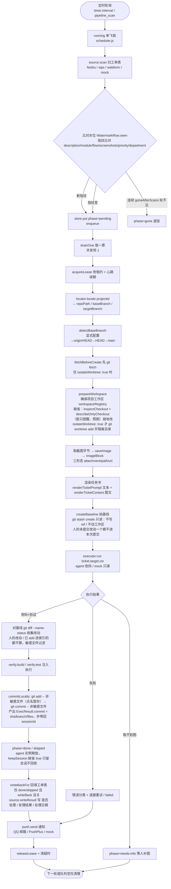
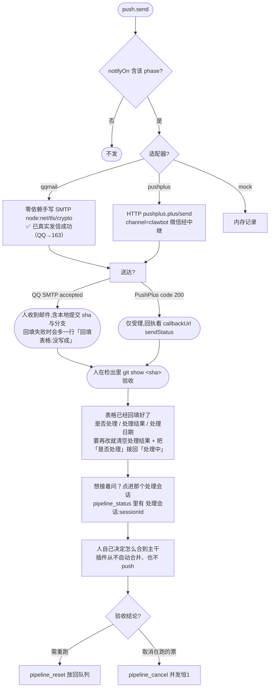
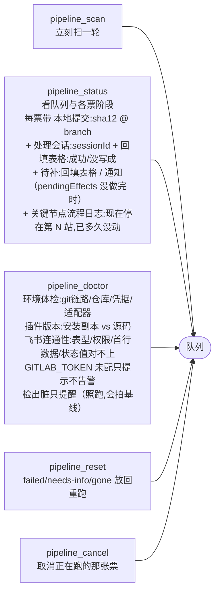

# 工单流水线插件 · 详细操作流程图

> 配套文档：`docs/ticket-pipeline/architecture.md`（四层契约 / 时序）、`docs/ticket-pipeline/feature-checklist.md`（完成度与缺陷）。
> 本图所有节点都对应 `plugins/ticket-pipeline/src` 里真实存在的代码路径（行号取自 2026-11-06 源码）。
> 节点标注：**⚠ = 当前仍卡住的缺口**，**✅ = 本轮已修**。汇总见文末第 7 节。

---

## 1. 总览时序（一次完整跑）



> 回填（`writeBackFor()`）三条硬约束：①**只写 `done` / `skipped`** —— `failed` 的票留在表里「处理中」是刻意留的信号；②**回填失败只记日志**，票态不回退、通知照发，人能从 `pipeline_status` 的「回填表格：没写成 —— …」看到原因；③**被取消就不写**。开关是 `writeBack`（缺省 `true`）与 `writeBackStatus`（缺省 `是`）。

> **关键节点流程日志（时间线）**：上面这整条链路的 9 个主站会被逐条记进票据的 `timeline` 字段，用 `pipeline_status` 排成时间线给人看。①获取工单（`scanAndEnqueue` 入队时）→ ②查找对应工单的项目（`locator.locate` 后）→ ③检查工作区（新建/复用/陈旧重建三种，`prepareWorkspace` 之后）→ ④创建会话（分支+模型，由执行器通过 `ctx.onFlow` 上报，只有真 agent 会记）→ ⑤处理工单问题 / ⑥跑验证 / ⑦提交（`onPhase` 自动按 `TIMELINE_NODES` 打点）→ ⑧回填工单表（`writeBackFor` 之后）→ ⑨发送消息（`notifyFor` 之后）。补充站（工作区就绪 / 规划改动 / 排队中 / 等你补充信息 / 已完成 / 待人工验证 / 失败 / 表格里已删除）以 `·` 记、不占站号。每条带写下时刻（`at`）、`✓/✗` 成败、一句中文补充；`pipeline_status` 末行直接写「现在停在第 N 站，已 X 分 Y 秒没动」，用来判断卡住。超时、取消、退避、失败、needs-info、租约丢失都记 ✗；启动补做的 ⑧⑨ 标注「补做 / 补发不是新一轮」。时间线是历史，修订/重新入队/人工重置不清空、只在末尾补一条「排队中」分隔、上限 80 条；写失败只记插件日志不影响跑票。

---

## 2. 工单扫描与入队（来源适配层）


> **扫描只读**：`scan()` 全程不写任何远端状态（飞书侧只发 auth / `records/search` 这类 GET）。唯一的写入口是同一条契约上的 `writeResult(recordId, { status, result, handledAt })`，在票跑完 `done` / `skipped` 之后由调度器调用一次 —— 为什么不把写藏在 `scan` 里，见架构 §5.2 与 [ADR 0006](../adr/0006-处理完回填工单表.md)。

> ℹ 上面 `feishu` 那条支路只画到多维表格（`records/search`）。**电子表格已支持**（2026-11-09 落地、11-10 补齐回填）：
> `resolveTable()` 是表型分派总闸（显式 `tableKind` → `spreadsheetToken` → `appToken` 双试 → `docNamePattern`），
> 电子表格走 `sheets/v2 .../values/:range` 读全表、按序号列认行身份。探测与扫描两张流程图见
> `docs/ticket-pipeline/feishu-sheet-source.md` §3.5 / §5.7。
>
> **定位工单表只有一个入口**（2026-11-10 夜）：项目卡片最上面的「工单表链接」，把浏览器地址整条贴进去，
> 不用先分辨多维表格还是电子表格 —— 适配器的 `extractSheetToken` 四种写法都认（`/sheets/<token>`、
> `/wiki/<token>`、裸 token、`shtcn…`），认不出就报 `invalid-input` 而不是拼出 404。

---

## 3. 执行器：agent 改码 → 验证 → 本地提交

```mermaid
flowchart TD
    E0([executor.run]) --> E1[agentOptionsFromConfig<br/>✅ 空 model 不下传,跟随会话默认]
    E1 --> E2[agents.create sessionId<br/>meta.cwd = workspacePath 项目工作区根<br/>✅ 宿主 attachSession 要求 cwd == 工作区路径]
    E2 --> E3[setupAgent 四件事]
    E3 --> E3a[1. 挂 preset: agentPresets.mount<br/>✅ 挂不上硬失败 invalid-input]
    E3 --> E3b[2. appendDelegatedPolicyOverrides 写策略]
    E3 --> E3c[3. 钉目录: workingDirectory.set → worktreePath<br/>✅ 仅 worktreePath ≠ workspacePath（isolateWorktree 打开）时才需要<br/>缺省模式两者相等,不需要这个服务]
    E3 --> E3d[4. attachSession 归属项目工作区<br/>失败只记日志,不影响改码]
    E3d --> E3e[createBaseline 拍基线<br/>git stash create 只造 commit 对象<br/>不写 ref / 不动工作区 / 不动索引<br/>拍不下来只记日志,降级按 baseCommit 收集]
    E3e --> E3f[snapshotProtectedPaths 拍受保护路径快照<br/>28 个官方 hook 名 + 10 个 git 元数据文件 + 4 个 cordis.*<br/>拿不到 readFile 服务就跳过自检并记日志]
    E3f --> E4[agent.followup 推任务书<br/>⚠ inject 不唤醒,必须 followup]
    E4 --> E5[waitForAgentIdle<br/>seq 连续静 2 次才认结束]
    E5 --> E6[collectChanges：有基线就对基线 git diff --name-status -z<br/>∪ git status --porcelain -z -uall；未跟踪文件哈希与基线相同则跳过<br/>✅ 人的改动一个都不进来；排除 .agents/worktrees]
    E6 --> E7{SENSITIVE_FILE_PATTERNS 命中?}
    E7 -->|是| E7a[✅ 拦下且写进提交说明的「未提交」一行,人 git show 就能看到]
    E7 -->|否| E8
    E7a --> E8[runVerification<br/>verify.build / verify.test 注入<br/>缺省 30 分钟超时（宿主 bash-local 缺省 10 分钟会夹下去）<br/>取消真 kill 子进程 / 超时返回退出码 124]
    E8 --> E9{有验证命令?}
    E9 -->|无| E9a[outcome=skipped<br/>phase 仍按契约给 done,但 plan.summary 前置写「⚠ 未通过验证」]
    E9 -->|有| E10[splitCommand 认单双引号<br/>✅ 但刻意不解释 && / 管道 / 重定向]
    E10 --> E11{退出码 0?}
    E11 -->|是| E12[outcome=passed]
    E11 -->|否| E13[outcome=failed]
    E12 --> E14[commitLocally<br/>git restore --staged 退回 agent 自己暂存的敏感文件<br/>git add -- 非删除的文件（点名暂存,不用 add -A）<br/>→ git commit -m 说明 -- 改动文件 ∪ 重命名旧路径]
    E13 --> E14
    E9a --> E14
    E14 --> E14b{compareProtectedSnapshots<br/>受保护路径动过?}
    E14b -->|否| E14a[git rev-parse HEAD<br/>取回 sha,并带出 branch / files / sessionId]
    E14b -->|是| E14c[unstageSensitiveFiles 撤回暂存<br/>转 failed + invalid-input（不可重试）并点名文件<br/>⚠ 「被发现」不是「被阻止」]
    E14c --> E22
    E14a --> E15{repo.gitlab.enabled === true?}
    E15 -->|否（缺省）| E22[commit 就是交付物<br/>不发任何 GitLab 请求、不要 GITLAB_TOKEN]
    E15 -->|是（显式打开远程出口）| E16[openDraftMr → resolveGitlab project,target<br/>✅ repo.gitlab{baseUrl,remote,projectId,enabled} 已能透传]
    E16 --> E17[ensureBranch GET /repository/branches/:branch]
    E17 --> E18[commitFiles POST /repository/commits<br/>actions[] 按文件内容物化]
    E18 --> E19{已有开放 draft MR?}
    E19 -->|是| E20[复用,不撞 409]
    E19 -->|否| E21[POST /merge_requests title:Draft:]
    E21 --> E21a[断言返回 draft===true]
    E20 --> E22
    E21a --> E22
    E22 --> E23[makeExecResult<br/>phase=done/skipped, testOutcome<br/>✅ 必须给 commit 或 mr 之一]
```

> **基线（`createBaseline`）为什么在 `followup` 之前拍**：它拍的是「agent 动手前」的样子，之后 `collectChanges` 只比这一份，所以人在这个检出里攒着的未提交改动、甚至已经 `git add` 进索引的改动，都不会混进本次提交。`git stash create` 是唯一一个只读的取基线方式 —— 它只造一个 commit 对象，不写 ref、不动工作区、不动索引（拍完 `git stash list` 仍是空的）。拍不下来（比如仓库有锁）只记日志，降级成按 `baseCommit` 收集，票不会因为「拍不到基线」而失败。
>
> **`keepSession` 管的是会话、不是 agent 实例**：`finally` 里 agent 实例**永远** `dispose()`（否则宿主侧会一直挂着一个跑着的 agent）。`keepSession !== false`（缺省 `true`）时只记一行日志「agent 已释放，会话保留」，会话留在项目工作区名下，人能在会话列表里点进去继续追问；只有显式 `keepSession: false` 才去调宿主的 `sessions` 服务（`close` / `dispose` / `closeSession` 三选一，调用永不抛）。
>
> **验证命令为什么必须有超时**：`runVerification` 走 `makeCommandRunner`，缺省 `VERIFY_TIMEOUT_MS = 30 * 60 * 1000`，超时返回 `VERIFY_TIMEOUT_EXIT_CODE = 124`；调用方 `signal` 已 abort 时直接抛 `PipelineError('aborted')`，跑到一半取消会真 kill 子进程。没有这一层时一条卡住的 build 会让 `runOne` 永远不返回 → 内存里 `running` 恒为 true → 整条流水线后面每一轮都判 `already-running` 静默停摆，而且 `pipeline_cancel` 也取消不了。注意宿主 `dsh-bash-local` 自己的 `maxTimeoutMs` 缺省 10 分钟，`clampTimeout` 取两者较小值 —— 真实上限是 10 分钟，要 30 分钟得改 profile。
>
> **篡改自检是「被发现」不是「被阻止」**：`snapshotProtectedPaths` 用 `readFile` 拍指纹（拿不到服务就跳过并记日志 —— 这是安全降级），`compareProtectedSnapshots` 在提交前比对；动了 `.git/hooks`（28 个官方 hook 名）、git 元数据（`config` / `HEAD` / `packed-refs` 等 10 个）或插件 profile（4 个 `cordis.*`）就把这些路径从 index 里 `git restore --staged` 撤回、整票转 `failed` + `invalid-input`（不可重试）并点名文件。agent 在自检之前**已经**写过这些文件了 —— 拦住的是「别把它提交出去」，不是「别写」。兜底只有 git 白名单 + 这一层自检，**不是硬隔离**（approval/policy 仍只能是 `never`）。
>
> **事后动作补偿**：终态那次 `setPhase` 会把 `pendingEffects`（回填表格 / 发通知）与终态同一次落库；做完一项就 `clearPendingEffect(key, ...)`（刻意不走 `setPhase`，否则会重写 `finishedAt`）。宿主重启后 `replayPendingEffects()` 扫残留终态票把没做完的补上。`enqueue` / `revise` / `resetByHuman` 都不继承上一轮的 `pendingEffects`。

---

## 4. 错误分类与重试 / 退避


> 限流识别（`executor-agent/agent-failure.js`）：从 `agent.session.log` 末条 `turn/end` 的 `data.reason.error` 取 code/message，命中 `RATE_LIMIT/QUOTA/SOFT_RATE` 或文案「被限流/rate limit/quota exceeded/429」→ 归一为 `PipelineError(rate-limit)`（可重试）。

---

## 5. 通知与人工闭环



---

## 6. 运维工具（对宿主暴露）



---

## 7. 当前卡点速查

状态基线（2026-11-11）：含**「凭据」页签填了 token 点保存什么都没发生**的修复 —— `lib/client.js` 的 `onSave()` 先算配置改动 `collectOps()`，为空就 `return`，而写凭据那段挂在这行 `return` 之后，于是「只填凭据、不动配置」时一个字节都没写进去，还回一句「没有需要保存的改动」；而页签计数把 `credDirty` 算进去了 ⇒ 能点、会涨、点了没用。现在凭据写入移到提前返回之前，两条通道互不阻塞（凭据失败只报凭据那条，配置照样发），只提交凭据时不再说那句假话。`client-smoke` 215 → **219 条**（4 条守着这个回归），`dev-run` 仍 **495/495**。

状态基线（2026-11-10 深夜）：含**体检补上「状态值口径」**（体检探针不再按「`appToken` 非空」就认定多维表格 —— wiki 链接写进 `appToken` 的裸 token 背后可能是电子表格，飞书回 `1254003` 时要能降级；缺省的 `statusValues` 只认「处理中」，体检会采样状态列前 100 行实际取值，对不上就报「状态值对不上」并给修法，只进提醒不进阻断），自测 **495/495** + 链路冒烟 11/11。

状态基线（2026-11-10 夜）：含**定位工单表只剩一个入口**（项目卡片最上面的「工单表链接」，`[wpsNotice, tokenRow, ...sections]`；`match.tableId` / `match.spreadsheetToken` / `match.sheetId` 三个输入框撤掉、面板项目字段 33 → 30）与**电子表格取票修复**（`extractSheetToken` 认 `/wiki/<token>`、带协议头却认不出时抛 `invalid-input`、`INVALID_INPUT_ERROR_CODES` 补 `1254003 WrongBaseToken` 让裸 token 能降级去试电子表格；`validateProject` 从「四选一」放宽成「至少一个定位依据」，两套 token 并存从静默放行改成警告），自测 **492/492** + 链路冒烟 11/11。

状态基线（2026-11-09）：含**飞书电子表格支持**（飞书同一平台下按表型分派：`get_node` 不再硬写 `obj_type`、`resolveTable` 是分派总闸（显式 `tableKind` → `spreadsheetToken` → `appToken` 双试 → `docNamePattern`）、`scan` 拆 `scanBitable` / `scanSheet`、新增 `src/adapters/source-feishu/sheets.js`（579 行纯函数）、`validateProject` 四选一放行、面板多一组「飞书电子表格」；**首版只读不回填**，电子表格的 `writeResult` 退化成只读回执而不是去拼一个必然 404 的 bitable 地址），自测 **451/451** + 链路冒烟 11/11；同轮还给 `repo.path` 加了「选择目录」按钮（接宿主 `uiWorkspace.pickDirectory()`）；此前含**「从 0 到 1」审计修掉的 5 件事**（凭据描述器改成惰性重取——以前 apply 时缓存 null 导致体检永久误报「凭据服务不可用」；`pipeline_doctor` 必须说出总开关状态——`enabled` 缺省 false，新用户配完永远等不到票而体检报「通过」；飞书**同步表**回填写不进去要退化成只读回执而不是 internal 可重试错误；**启动恢复终态统一回 `pending`**——以前恢复成 planning/testing，而 `pickNext()` 只挑 pending，票会「看起来恢复了、其实再也不会动」；`工作区就绪` 与 `检查工作区` 两站不再说同一句话），当轮自测 384/384；此前含**`appToken` 贴整条表格链接就够**（`parseBitableUrl` 住在 `src/contracts/types.js`，配置校验与飞书适配器共用：`?table=` → `table_id`、`?view=` → `view_id`，显式 `tableId` 仍优先；此前只有适配器认得这个写法，配置里只贴一条链接会被 `validateConfig` 拦在启动前），自测 382/382 + 链路冒烟 11/11；此前含配置页**页签式改版**（项目 / 参数 / 凭据 / 体检四个页签、一次只画一页、下划线式页签 + 宿主 `settings-card-*` token，见 `feature-checklist.md` §1.17）、插件版本自检（`pipeline_doctor` 第 5 节比对安装副本与源码）、「回填工单表 / 保留会话 / 只提交 agent 改过的文件 / 设置面板补齐」四项改造、选择分支、配置页 UI/UX 大改造，以及 5 条上线阻断项 + 4 条重要项的加固（适配器名强校验、验证超时与取消、敏感名单 8 类 41 条、`.git`/profile 篡改自检、`pendingEffects` 补偿、租约诚实化），再加上**关键节点流程日志（时间线）**——票据 `timeline` 逐站打点、`pipeline_status` 直接写「现在停在第 N 站，已 X 分 Y 秒没动」。

| # | 卡点 | 类型 | 现状 |
| --- | --- | --- | --- |
| P0-3 | 金山无开放平台取数通道 | 取数缺口 | **待接**。只有 `match.sheetUrl` + 全局 fetch（大概率要登录态）或宿主注入 `fetchSheet` |
| P0-6 | 真实飞书表截图是 url 形态，白名单缺省为空 | 配置缺口 | **已能配**（`match.allowedImageHosts`），但要对这张表放开仍需显式填域名 |
| P1-12 | 金山 recordId 用行号 `'r'+rowIndex` | 健壮性 | **已知代价**，未改（插行会让票换身份，代码注释已声明） |
| P1-13 | `pushplus.token` 明文配置 | 安全 | **待改**（QQ 邮箱那条走 `QQMAIL_AUTH_CODE` 凭据，不落配置） |
| P1-7 | 执行器返回 `phase:'failed'` 结果不进退避重试 | 契约耦合 | **已绕开**：限流改成抛 `PipelineError('rate-limit')`（见架构 §8.4） |
| P1-8 | 没配验证命令时 `testOutcome='skipped'` 而 `phase` 仍是 `done` | 正确性 | **已缓解**：契约不变，但 `plan.summary` 最前面写「⚠ 未通过验证（skipped）」 |
| P1-14 | ~~GitLab Commits API 是改动唯一出口~~ | 契约耦合 | **已改**：交付形态改为工作区检出里的本地提交（`commitLocally`）；远程 Commits API 降级成 `repo.gitlab.enabled: true` 才走的可选出口 |
| P2 | 上游模型配额（workbuddy 429 `quota_exceeded`） | 外部因素 | 与插件无关；执行器现在会如实报 `rate-limit` |
| P1-16 | ~~飞书源只支持**多维表格**，电子表格进不来~~ | 取数缺口 | **已修（2026-11-09 落地，11-10 补齐）**。当时是代码路径问题不是权限问题：`normalizeAppToken` 把 `obj_type:'bitable'` 硬写进 query，`sheet` 被服务端判成「不是多维表格」；`config.js` 只认「appToken+tableId」或「docNamePattern」。现在 `get_node` 的 query 只剩 `token`、表型读 `node.obj_type`，`resolveTable` 成为表型分派总闸，新增 `sheets.js`（694 行纯函数），回填也补齐了（按序号列重定位行）。2026-11-10 夜又修了两处拦路：`extractSheetToken` 不认 `/wiki/<token>`（整条 wiki URL 被原样拼进接口 → 404）、`1254003 WrongBaseToken` 没归进 `INVALID_INPUT_ERROR_CODES`（裸 token 因此永远降级不到电子表格分支）。**真表已读过**（`row_count: 199`，表头 10 列与语义字段对得上） |
| P1-17 | 回填工单表需要飞书应用有**编辑**权限 | 权限缺口 | **已实现、待真表验证**。只有读权限时写回返回 `code 91403 Forbidden`；这时票仍是 `done`，只是 `pipeline_status` 显示「回填表格：没写成 —— …」。把应用加成可编辑协作者再验一次即可（见 `feature-checklist.md` §8.2） |
| P1-18 | `keepSession` 依赖宿主的 `sessions` 服务 | 依赖缺口 | **缺省不需要**：缺省 `keepSession: true`，只留会话不回收，完全不碰该服务；只有显式 `keepSession: false` 才调 `close` / `dispose` / `closeSession`（三选一，调不通也不影响票态） |
| P1-22 | ~~验证命令没有超时，一条卡住的 build 会让整条流水线静默停摆~~ | 阻断 | **已修**：`VERIFY_TIMEOUT_MS` 30 分钟缺省、超时退出码 **124**、取消真 kill（宿主 `bash-local` 的 `maxTimeoutMs` 缺省 10 分钟会夹下去） |
| P1-23 | ~~适配器名写错静默退回 mock（假执行却报成功）~~ | 阻断 | **已修**：`workExecutor` / `pushAdapter` 加 `enum`，`pickAdapterFactory()` 查不到抛 `invalid-input` 并列可用值 |
| P1-24 | ~~agent 能改 `.git/hooks` 与插件 profile~~ | 阻断 | **已缓解**：提交前 `compareProtectedSnapshots` 自检（28 hook 名 + 10 git 元数据 + 4 `cordis.*`），动过就撤回暂存并整票 `failed`。**是「被发现」不是「被阻止」**，approval/policy 仍只能 `never` |
| P1-25 | ~~终态与事后动作（回填 / 通知）不是同一次落库~~ | 健壮性 | **已修**：`pendingEffects` 与终态同一次 `setPhase`，启动时 `replayPendingEffects()` 补做 |

> 本轮（上线加固）已关闭：**P1-22** 验证无超时、**P1-23** 适配器名静默退 mock、**P1-25** 事后动作可能永久丢；**P1-24** 从「完全没拦」改成「提交前发现并判失败」。另把租约口径从「CAS」正名为「best-effort 租约，不是原子 CAS」（宿主 storageDomain 的 table API 没有 compare-and-swap 原语）。明细见 `feature-checklist.md` §1.14。

> 本轮已关闭（提交 `5b94a17` / `26f0391`）：**P0-1** `{{model}}` 模板崩（改为配置留空时向宿主 `agentDefaultModel` 补齐）、**P0-2** preset 挂不上改硬失败、**P0-4** `repo.gitlab` 透传、**P0-5** 金山「待修改项目」→ `targetProject`、**P0-6** `allowedImageHosts` 配置键、**P1-9/10** 敏感文件上报与 verify 命令认引号、**P1-11** `recordIds` 推广到 wps/mock/webform。
>
> 本轮（工作树改造）已关闭：**P1-14** 远程 Commits API 是唯一出口 —— 改为工作区检出里的本地提交优先，远程 MR 变成 `repo.gitlab.enabled: true` 才走的可选出口。
>
> 本轮（四项改造）已关闭：**P1-15** 处理完还得人工改表 → 回填工单表（`TicketSource.writeResult` 是唯一写入口，只写 done/skipped 三列）；**P1-19** 处理完会话找不回来 → `ExecResult.sessionId` + `keepSession` 把会话留在项目工作区名下；**P1-20** 检出不干净就拒跑 → 改成 `createBaseline()` 拍只读基线、只提交 agent 真正改过的文件；**P1-21** 设置页只能改全局配置 → `projects` 子树可编辑（25 字段）+ 第三个 Remote 方法 `ticketPipeline.projects()`。
>
> 本轮同时改掉「每票必开隔离 worktree」这个隐含前置：缺省直接在项目工作区的检出里改（**脏也能跑**，只提醒不拒跑），`isolateWorktree: true` 才退回 `git worktree add`；清理侧加 `isIsolatedWorktreePath()` 前缀校验，防止 `git worktree remove --force` 误删人的主检出。
>
> 本轮（改动收集改 `git -z`）已关闭三个会静默丢改动的缺陷：①`git diff` 看不见未跟踪新文件（agent 新建的文件既不提交、还会被误判成「没有产生任何文件改动」）；②非 `-z` 输出下中文名是八进制转义、含空格名带引号、未跟踪目录被折叠成一个目录名（敏感文件因此绕过拦截）；③插件自己的 `.agents/worktrees` 让主检出恒脏（缺省模式直接拒跑）。详见 `feature-checklist.md` §1.4。
